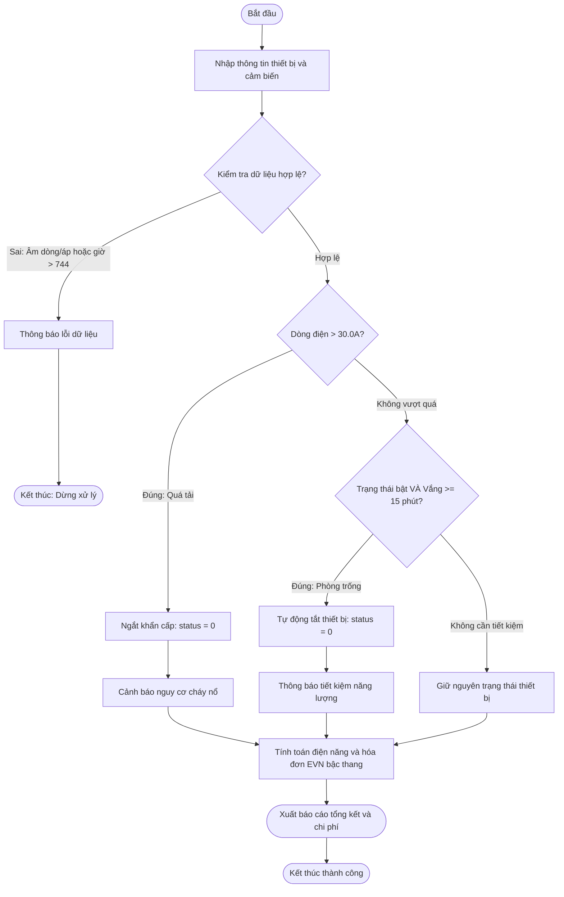

# BÁO CÁO PHÂN TÍCH THIẾT KẾ MODULE QUẢN LÝ CỤM THIẾT BỊ PHÒNG THÔNG MINH BẰNG STRUCT

> 👤 **Học viên:** Hoàng Công Dũng | **Mã SV:** PTIT-HCM-009
> 🏫 **Môn học:** it102-rl-hoangcongdung

---

## 📊 Sơ đồ thiết kế hệ thống (Activity Diagram)

> 💡 *Sơ đồ dưới đây được render tự động trực tiếp trên GitHub bằng Mermaid. Bạn cũng có thể tải file **`bt2.drawio`** trong repository này để mở và chỉnh sửa trực tiếp trên [Draw.io (diagrams.net)](https://app.diagrams.net).* 

---

## 1. Mục tiêu và Bối cảnh bài toán

Bài tập 02 xây dựng module quản lý năng lượng và an toàn hạ tầng điện cho Rikkei SmartHome, sử dụng struct trong C.

Hệ thống giải quyết các rủi ro vận hành như điều hòa chạy khi phòng trống, sụt áp giờ cao điểm, đồng thời tính toán chi phí theo bậc thang EVN.

- Sử dụng 2 cấu trúc thuần túy SmartDevice và EnergySensor.
- Áp dụng quy tắc truy xuất qua toán tử dấu chấm (.) mà không dùng mảng cấu trúc hay hàm ngoài main().

## 2. Phân tích nghiệp vụ và Quy tắc xử lý ngoại lệ

Chương trình tuân thủ thứ tự ưu tiên xử lý: Kiểm soát an toàn điện -> Tự động hóa tiết kiệm năng lượng -> Tính toán hóa đơn EVN.

Các bẫy dữ liệu (Edge Cases) được kiểm tra kỹ lưỡng trước khi thực thi tính toán tài chính.

- Kiểm soát an toàn: Dòng điện vượt ngưỡng 30.0A ngay lập tức ngắt thiết bị (status về 0) và cảnh báo cháy nổ.
- Tiết kiệm năng lượng: Thiết bị đang bật nhưng phòng vắng từ 15 phút trở lên sẽ tự động tắt.
- Bẫy dữ liệu 1: Điện áp, dòng điện hoặc thời gian vắng người âm -> Dừng chương trình.
- Bẫy dữ liệu 2: Giờ vận hành trong tháng phải nằm trong khoảng từ 1 đến 744 giờ.

## 3. Bảng đặc tả chi tiết quy trình xử lý

Bảng mô tả các bước xử lý logic trong module điều khiển trung tâm:

| Bước | Thành phần | Hành động thực hiện | Điều kiện và Kết quả |
| --- | --- | --- | --- |
| 1 | Hệ thống | Nhập thông tin SmartDevice và EnergySensor | Đọc các giá trị từ bàn phím |
| 2 | Kiểm tra lỗi | Kiểm tra voltage < 0, current < 0, unoccupancy < 0 hoặc operatingHours ngoài [1, 744] | Nếu sai: Thông báo lỗi và dừng |
| 3 | An toàn điện | Kiểm tra currentAmperes > 30.0 | Nếu đúng: status = 0, cảnh báo nguy cơ cháy nổ |
| 4 | Tiết kiệm | Kiểm tra status == 1 VÀ unoccupancyMinutes >= 15 | Nếu đúng: status = 0, thông báo tiết kiệm điện |
| 5 | Tính điện năng | Tính tổng kWh = ratedPowerKW * operatingHours | Chuẩn bị dữ liệu tính bậc thang |
| 6 | Tính tiền điện | Áp dụng biểu giá 4 bậc EVN cho tổng kWh | Tính chính xác tổng chi phí chưa VAT |
| 7 | Xuất báo cáo | In trạng thái thiết bị cuối cùng và hóa đơn | Hoàn thành quy trình |

## 4. Hướng dẫn sử dụng mã nguồn và Triển khai GitHub

Mã nguồn được viết bằng ngôn ngữ C chuẩn ANSI C / C11, lưu tại thư mục src/main.c.

Toàn bộ tài liệu báo cáo và sơ đồ thiết kế nằm trong thư mục docs/ của tổ chức GitHub it102-rl-hoangcongdung.

---

## 📁 Danh sách tệp tin nộp bài trong Repository
- 📝 `bt2.docx`: Báo cáo tài liệu phân tích nghiệp vụ hoàn chỉnh.
- 🎨 `bt2.drawio`: File thiết kế sơ đồ chuẩn theo quy định đề bài (mở trực tiếp bằng [Draw.io](https://app.diagrams.net) hoặc Lucidchart).
- 💻 `main.c`: Mã nguồn chương trình.
